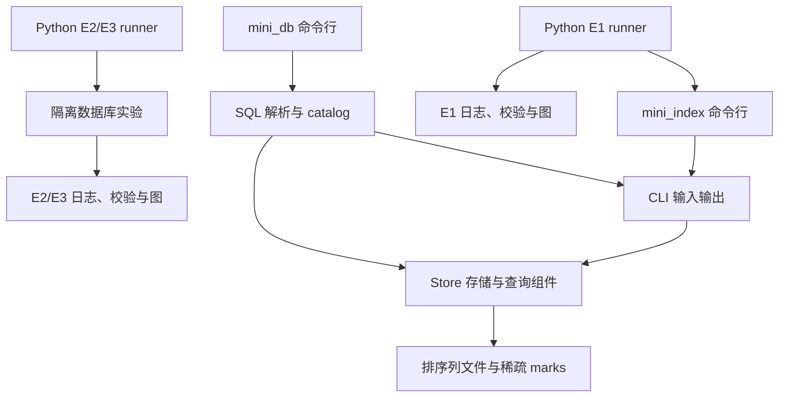

# 项目结构与组件索引

本项目研究单列稀疏主索引如何减少候选扫描量。核心采用 C++17；Python 组织数据、实验、结果校验与绘图。`mini_index` 是机制实验入口，`mini_db` 是复用同一存储引擎的教学数据库入口。

## 目录职责

| 路径 | 内容与用途 |
| --- | --- |
| `mini-index/src/` | 可复用的 C++ 组件与两个命令行入口 |
| `mini-index/tests/` | 持久化、重新打开、随机查询、非法输入与数据库测试 |
| `mini-index/examples/` | 小型 TSV 数据和 SQL 演示 |
| `configs/` | E1 参数、E2/E3 参数和 ClickHouse 资源配置 |
| `scripts/` | Python 实验调度、结果校验、绘图与脚本回归测试 |
| `sql/` | 原生机制验证 DDL 与第三方工作负载署名 |
| `results/` | 已保留的实验记录、图、SQL 版本和来源信息 |
| `reproduction-info/` | 环境准备记录及本次整理的来源清单 |
| `docs/` | 当前工程的结构和开发说明 |
| `report/` | 课程报告、个人贡献和视频材料入口 |
| `data/` | 本地数据入口；大文件不纳入 Git |
| `build/` | 本地构建输出；不纳入 Git |

`results/` 中的文件是历史实验依据；新实验另建唯一的 suite 目录。构建和测试产生的临时数据不写入历史 suite。

## C++ 组件

| 组件文件 | 职责 | 对应 CMake 目标 |
| --- | --- | --- |
| [`store.hpp`](../mini-index/src/store.hpp) | `Row`、`Mark`、`Result`；小端二进制读写；排序与列式落盘；manifest 校验；稀疏索引计划；共享扫描和检查溢出的聚合 | `mini_index_core` |
| [`cli_support.hpp`](../mini-index/src/cli_support.hpp) | 严格整数解析、TSV 导入、JSON 结果输出 | `mini_index_cli` |
| [`database.hpp`](../mini-index/src/database.hpp) | 受限语法解析、catalog、固定 schema、一次性导入、SELECT 和 EXPLAIN | `mini_database` |
| [`main.cpp`](../mini-index/src/main.cpp) | `build`、`query`、`benchmark` 命令 | `mini_index` |
| [`database_main.cpp`](../mini-index/src/database_main.cpp) | 单条 SQL、SQL 文件或标准输入批处理 | `mini_db` |

前三个组件为 header-only 实现，CMake 用 `INTERFACE` 库传递头文件、C++17 要求与依赖。两个 `.cpp` 负责各自的程序入口。保留原有源文件路径，便于与历史实验的源码快照和哈希对应。

## 查询与持久化

导入记录按 `(key, row_id)` 排序，生成 `row_id.bin`、`key.bin` 和 `value.bin`。每个 granule 的首个 key、组号和行位置写入 `index.bin`；`manifest.txt` 记录版本、类型、行数及 granule 大小。

`Store::plan` 确定候选行区间。全扫描覆盖全部行；索引扫描通过稀疏 marks 保守定位候选 granule。两条路径随后使用同一读取、谓词过滤和聚合逻辑。等值谓词独立处理，范围谓词使用半开区间 `[L,U)`，避免最大有符号整数的加一溢出。

`mini_db` 在 Store 之外增加 catalog 与表 schema。`EXPLAIN` 与 SELECT 共用查询计划，输出候选扫描行数和 granule 数；候选行数不等于最终匹配行数。

## Python 组件与实验

| 入口 | 作用 |
| --- | --- |
| [`run_mechanism.py`](../scripts/run_mechanism.py) | E1：生成固定数据和查询、快照源码、构建、校验并运行 24 组机制配置 |
| [`validate_results.py`](../scripts/validate_results.py) / [`plot_results.py`](../scripts/plot_results.py) | 校验 E1 日志与摘要；从摘要重建图 |
| [`database_support.py`](../scripts/database_support.py) | E2/E3 共用的数据规范化、结果比较、SQL 适配和许可保留 |
| [`run_databases.py`](../scripts/run_databases.py) | E2 原生索引观测及 E3 三数据库 43 查询调度 |
| [`validate_databases.py`](../scripts/validate_databases.py) / [`plot_databases.py`](../scripts/plot_databases.py) | 校验 E2/E3 证据、387 条状态与工作负载来源；重建图 |

E1 对比自主组件的两条路径；E2 观察 ClickHouse 原生机制；E3 比较完整数据库系统。三类证据回答不同问题，三库耗时差异不能直接归因于单个索引机制。

## 当前边界

Store 为不可变、单进程组件；数据库入口只支持固定三列、一次性导入、COUNT/SUM、等值或范围查询及 EXPLAIN。通用 SQL、事务、并发写入、多 part 合并、压缩、分布式与网络服务均不在本实现中。完整语法和格式见 [`mini-index/DATABASE.md`](../mini-index/DATABASE.md) 与 [`mini-index/README.md`](../mini-index/README.md)。
